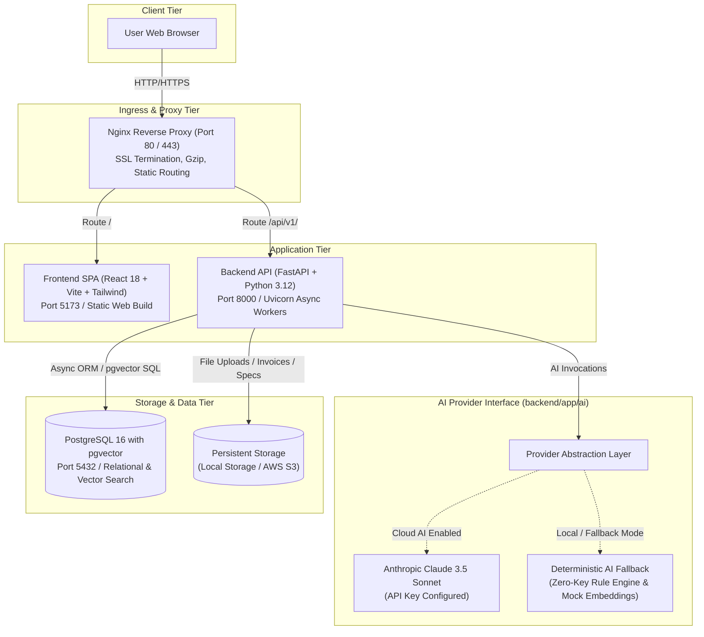

# TradeX AI: Architecture Specification & System Blueprint

> **Problem Statement:**  
> B2B buyers struggle to discover, evaluate and compare suppliers because product data, capabilities, pricing, certifications and documents are fragmented. The platform lets buyers and suppliers manage products, supplier profiles, RFQs/inquiries and trade documents in a web app, with an AI layer that understands natural-language requirements, finds products and suppliers, extracts data from uploaded documents and recommends suppliers. It runs as a secure multi-container system with Docker and Nginx on AWS EC2, with Jenkins and Amazon ECR CI/CD, persistent storage, HTTPS, monitoring and secure configuration.

---

## 1. High-Level Architecture Diagram

---

## 2. Platform Modules & API Boundaries

| Module | API Prefix | Primary Database Tables | Frontend Pages & Views | Scope Type |
|---|---|---|---|---|
| **Authentication & Users** | `/api/v1/auth`, `/api/v1/users` | `users`, `user_roles`, `user_sessions` | `/login`, `/register`, `/profile` | Real |
| **Supplier Profiles** | `/api/v1/suppliers` | `suppliers`, `supplier_certifications`, `supplier_capabilities` | `/suppliers`, `/suppliers/:id`, `/supplier/dashboard` | Real |
| **Product Catalog** | `/api/v1/products` | `products`, `product_categories`, `product_specifications` | `/products`, `/products/:id`, `/catalog/manage` | Real |
| **AI Search & Matching** | `/api/v1/search` | `product_embeddings`, `supplier_embeddings`, `search_history` | `/search`, `/matching` | Real |
| **RFQ & Quotations** | `/api/v1/rfqs` | `rfqs`, `rfq_items`, `quotes`, `quote_comparisons` | `/rfqs`, `/rfqs/new`, `/rfqs/:id`, `/quotes/compare` | Real |
| **Negotiation & Chat** | `/api/v1/negotiations` | `negotiation_threads`, `negotiation_messages` | `/negotiations`, `/negotiations/:id` | Real |
| **Orders & Tracking** | `/api/v1/orders`, `/api/v1/shipments` | `orders`, `order_items`, `shipments`, `shipment_events` | `/orders`, `/orders/:id`, `/tracking/:tracking_no` | Real |
| **Document AI** | `/api/v1/documents` | `trade_documents`, `extracted_document_fields` | `/documents`, `/documents/upload`, `/documents/:id` | Real |
| **AI Trade Copilot (RAG)**| `/api/v1/copilot` | `copilot_conversations`, `copilot_context_chunks` | `/copilot` | Real |
| **Analytics & Reporting** | `/api/v1/analytics` | `analytics_events`, `trade_metrics_daily` | `/analytics`, `/reports` | Real |
| **Admin Console** | `/api/v1/admin` | `audit_logs`, `system_settings`, `feature_flags` | `/admin`, `/admin/users`, `/admin/audit` | Real |
| **Payments & Escrow** | `/api/v1/simulated/payments` | `simulated_escrow_accounts`, `simulated_transactions` | `/simulated/escrow` | Simulated |
| **Trade Finance** | `/api/v1/simulated/finance` | `simulated_credit_lines`, `simulated_factoring_requests`| `/simulated/finance` | Simulated |
| **Customs & Compliance** | `/api/v1/simulated/customs` | `simulated_customs_declarations`, `simulated_tariffs` | `/simulated/customs` | Simulated |
| **Freight & Logistics** | `/api/v1/simulated/freight` | `simulated_freight_rates`, `simulated_routes` | `/simulated/freight` | Simulated |

---

## 3. Architecture Principles & Layer Boundaries

1. **Frontend Isolation:**
   - Single-Page Application (SPA) built with React 18 and Vite.
   - All server communication is abstracted through `frontend/src/lib/api/client.ts` with strict TypeScript types.
   - Feature modularity: Each domain feature resides in its own isolated folder under `frontend/src/features/<feature-name>`.

2. **Backend Domain Layering:**
   - **Router (`api/v1/`):** Thin controllers handling HTTP validation, status codes, and routing.
   - **Schemas (`schemas/`):** Pydantic v2 input/output validation contracts.
   - **Services (`services/`):** Pure domain logic, orchestration, and business rules.
   - **Repositories (`repositories/`):** Data access layer using SQLAlchemy 2 async sessions.
   - **Models (`models/`):** Declarative database entity schemas.
   - **AI Layer (`ai/`):** Strict provider pattern isolating LLM vendors from business logic.

3. **Data Integrity & Vector Search:**
   - PostgreSQL 16 relational integrity with foreign keys, indexes, and transactions.
   - `pgvector` vector extension for hybrid keyword and cosine-similarity semantic supplier/product discovery.

4. **Security & Deployment Boundaries:**
   - Nginx acts as the single public entry point, forwarding API calls to FastAPI and static assets to the frontend build.
   - Multi-stage Docker builds ensuring minimal runtime container attack surfaces.

---

## 4. 25-Step Build Plan Roadmap

- **Step 1:** Architecture, Monorepo Scope, Standing Rules & Foundations *(Current)*
- **Step 2:** Database Foundation, pgvector Extension Setup, Alembic Migrations & Base Models
- **Step 3:** Authentication, RBAC (Buyer, Supplier, Admin), JWT Tokens & User Profiles
- **Step 4:** Supplier Profiles, Verification Status, Capabilities & Certifications
- **Step 5:** Product Catalog, Multi-Tier Categories, Specifications & Inventory
- **Step 6:** AI Embeddings & Vector Indexing Engine with Deterministic Fallback
- **Step 7:** AI Semantic Search & Multimodal Product Discovery Interface
- **Step 8:** Supplier Matching Algorithm & Compatibility Scoring
- **Step 9:** RFQ (Request for Quotation) Lifecycle & Buyer Requisition Portal
- **Step 10:** Supplier Quote Submission & Cost Breakdown Management
- **Step 11:** AI Multi-Quote Comparative Analysis & Risk Assessment Matrix
- **Step 12:** Real-Time B2B Negotiation Chat & Counter-Offer Engine
- **Step 13:** Purchase Order Lifecycle & Milestone Contract Generation
- **Step 14:** Multi-Modal Shipment Tracking & Milestone Timeline Tracker
- **Step 15:** Simulated Payment Processing, Escrow Hold & Milestone Release
- **Step 16:** Simulated Trade Finance, Invoice Factoring & Credit Lines
- **Step 17:** Document AI: Automated Trade Document Extraction & Spec Ingestion
- **Step 18:** Simulated Customs Tariff Calculator & Compliance Pre-Clearance
- **Step 19:** Simulated International Freight Rate & Container Estimator
- **Step 20:** AI Trade Copilot with RAG (Retrieval-Augmented Generation) & Market Insights
- **Step 21:** Buyer & Supplier Performance Analytics Dashboard
- **Step 22:** System Administration Console, Audit Logs & Platform Governance
- **Step 23:** Multi-Container Docker Compose Production Orchestration & Nginx SSL Hardening
- **Step 24:** Automated Jenkins CI/CD Pipeline & Amazon ECR Build Automation
- **Step 25:** End-to-End Verification, Performance Benchmarking & Production Readiness
