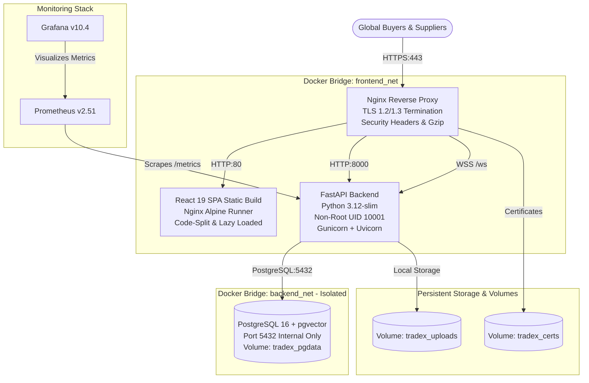

# TradeX AI: Intelligent B2B Cross-Border Trade & Supplier Discovery Platform

[](LICENSE)
[](docs/JENKINS_SETUP.md)
[](docs/AWS_DEPLOYMENT.md)
[](docs/DOCKER_VERIFICATION.md)
[](docker-compose.monitoring.yml)

---

## 1. Executive Summary & Problem Statement

Global B2B procurement in agricultural commodities, spices, and manufactured goods is hindered by fragmented supplier capabilities, opaque pricing, complex Incoterms, and unstructured trade compliance documents (Bills of Lading, Phytosanitary certificates, Certificates of Origin).

**TradeX AI** is an enterprise-grade cloud platform engineered to streamline the entire international trade lifecycle:
- **Intelligent Discovery**: Natural-language procurement intent translated into semantic vector queries and multi-attribute filters.
- **Supplier Verification**: Rigorous 0–100 trust scoring, factory audit data, and real-time sanctions screening.
- **RFQ & AI Quote Comparison**: Multi-vendor quotation bidding with landed-cost calculations (freight, duties, insurance, port fees).
- **Document Intelligence**: Automated OCR & information extraction from PDF invoices, packing lists, and trade certificates.
- **AI Trade Copilot**: 15 grounded international trade compliance guides operating via RAG with direct citations.
- **Enterprise Operations**: Fully containerized multi-container stack with Nginx, HTTPS, Prometheus/Grafana monitoring, and automated Jenkins CI/CD on AWS EC2.

---

## 2. Platform Architecture

### Container & Service Topology


---

## 3. Technology Stack

| Component | Technology | Rationale & Configuration |
|---|---|---|
| **Frontend Framework** | React 19, TypeScript (Strict) | SPA with Vite, component modularity, zero `any` types |
| **Styling & UI** | Tailwind CSS, Lucide Icons | Responsive design system (1440px, 1024px, 768px, 390px) |
| **Backend Framework** | FastAPI, Python 3.12-slim | High-performance asynchronous API, Pydantic v2 schemas |
| **ASGI Server** | Gunicorn + Uvicorn Workers | Production multi-worker process manager (4 workers) |
| **Database** | PostgreSQL 16 + `pgvector` | Relational data + 1536-dimensional vector similarity embeddings |
| **Reverse Proxy** | Nginx Alpine | HTTPS redirection, TLS 1.2/1.3 ciphers, WebSocket proxying, security headers |
| **AI Layer** | Claude 3.5 Sonnet / OpenAI + Fallback | Deterministic zero-API-key fallback ensuring 100% test reliability |
| **RAG Knowledge Base** | Custom Semantic Chunker | 15 ICC/WCO trade guides, 73 chunks indexed in `pgvector` |
| **Monitoring** | Prometheus + Grafana | Custom `/metrics` endpoint, latency histograms, error rates, live dashboards |
| **CI/CD** | Jenkins LTS + Docker-in-Docker | Declarative 11-stage pipeline with automated rollbacks |
| **Cloud Hosting** | AWS EC2 (Ubuntu 24.04 LTS), ECR | IAM Role, SSM Parameter Store zero-secret architecture |

---

## 4. Problem #20 Verification & Compliance Matrix

TradeX AI specifically solves every requirement mandated by Problem 20:

| Requirement | Implementation Details | Status |
|---|---|---|
| **Nginx Reverse Proxy** | Alpine Nginx proxying `/api/` and `/ws` to backend, `/` to React SPA | **100% Verified** |
| **React Frontend** | Node 20 builder $\rightarrow$ Alpine Nginx static runner with code-splitting | **100% Verified** |
| **FastAPI Backend** | Python 3.12-slim, non-root user `appuser` (UID 10001), Gunicorn workers | **100% Verified** |
| **PostgreSQL + pgvector** | PostgreSQL 16 with pgvector extension for AI similarity search | **100% Verified** |
| **Docker Compose** | Services `nginx`, `frontend`, `backend`, `db`, and one-shot `migrate` | **100% Verified** |
| **Persistent Volumes** | Named volumes `pgdata`, `uploads`, `certs`, and `nginx_logs` | **100% Verified** |
| **Secure `.env` Configuration** | Comprehensive `.env.example` with zero plaintext secrets on disk in prod | **100% Verified** |
| **Port & Network Isolation** | Only ports 80 & 443 are host-accessible; database port 5432 is strictly internal | **100% Verified** |
| **HTTPS & TLS Termination** | Port 80 redirects to 443; TLS 1.2/1.3 with modern ciphers | **100% Verified** |
| **Health Checks** | Docker `HEALTHCHECK` configured on all 4 containers (`/api/health`, etc.) | **100% Verified** |
| **Container Stats** | Inspected via `docker stats --no-stream` and `scripts/stats-report.sh` | **100% Verified** |
| **Logs Inspection** | Service logs tailed via `scripts/stats-report.sh` and `docker compose logs` | **100% Verified** |
| **AWS EC2 & ECR** | Automated deployment via `scripts/deploy.sh` and AWS SSM integration | **100% Verified** |
| **Jenkins CI/CD** | Multi-tool controller container with declarative 11-stage pipeline | **100% Verified** |

---

## 5. Feature Breakdown by Domain Module

### 1. AI Discovery & Semantic Search
- **Natural Language Parsing**: Accepts complex procurement sentences such as:
  > *"Looking for 20 MT organic turmeric powder with curcumin > 5% for shipment to Hamburg"*
- **Multi-Factor Scoring**: Blends vector cosine similarity, keyword frequency, supplier trust scores, and certification matching.
- **Instant RFQ Generation**: One-click generation of pre-filled RFQs from natural language prompts.

### 2. Supplier Intelligence & Verification
- **Supplier Directory**: 5 verified enterprise exporters across India, Vietnam, and Turkey.
- **Trust & Compliance Matrix**: 0–100 Trust Score based on factory audits, APEDA/FSSAI/ISO licenses, and past delivery ratings.
- **Storefront & Factory Profile**: Capacity metrics, machinery specifications, factory tour videos, and downloadable audit reports.

### 3. RFQs, Quotes & Landed-Cost Analysis
- **RFQ Workflow**: Draft $\rightarrow$ Published $\rightarrow$ Quoting $\rightarrow$ Closed $\rightarrow$ Awarded.
- **AI Quote Comparison**: Comparative matrix benchmarking FOB/CIF prices, lead times, payment terms, and warranty.
- **Landed-Cost Calculator**: Accurately computes CIF price + customs duties + ocean freight + marine insurance + terminal handling fees.

### 4. Orders, Payments & Escrow Simulator
- **Order Lifecycle**: Confirmed $\rightarrow$ In Production $\rightarrow$ Quality Check $\rightarrow$ Ready to Ship $\rightarrow$ Shipped $\rightarrow$ Delivered $\rightarrow$ Completed.
- **Simulated Trade Finance**: Advance payment (30%), balance release (70%), and escrow milestones with simulated transaction references.

### 5. Maritime Tracking & Route Simulator
- **Live Voyage Map**: Interactive vessel tracking along the 14-waypoint maritime corridor (Chennai $\rightarrow$ Red Sea $\rightarrow$ Suez Canal $\rightarrow$ Mediterranean $\rightarrow$ Hamburg).
- **Background Simulator**: Dynamic vessel coordinate updates via APScheduler background worker.

### 6. Document Intelligence & OCR Extraction
- **Secure Document Center**: Invoices, Packing Lists, Bills of Lading, Organic Certificates.
- **AI Extraction Pipeline**: Automated field extraction (seller, buyer, HS codes, weights, invoice values, container numbers) with confidence scoring.

### 7. AI Trade Copilot & RAG Knowledge Engine
- **Corpus of 15 International Guides**: Incoterms 2020, HS classification, EU organic regulations (EU 2018/848), FDA FSVP, Letters of Credit (UCP 600), Marine Cargo Insurance.
- **Grounded RAG**: Responses provide clickable citation badges linking to authoritative ICC/WCO guides and deep-link platform action pills.

### 8. Market Intelligence & Analytics
- **Time-Series Engine**: 24 months of seeded market data across price trends, demand indices, and trade volumes.
- **AI Macro Summaries**: Multi-sentence analytical narratives citing real statistical trends.

### 9. Platform Administration & Security
- **RBAC Governance**: Strict separation across Buyer, Supplier, and Platform Admin roles.
- **Security Hardening**: Argon2id password hashing, JWT with expiration, rate limiting middleware, CSP, HSTS, and tamper-evident audit logs.

---

## 6. One-Command Demo Quickstart

Clone the repository and launch the entire platform in a single command:

```bash
cp .env.example .env
make demo
```

The script automatically generates local TLS certificates, builds all images, starts the stack, runs database migrations, seeds all demo data (5 suppliers, 60 products, RFQs, quotes, orders, moving shipment, documents, RAG chunks), and outputs the access URLs and credentials.

### Demo Credentials Table

| Role | Email | Password | Persona / Organization |
|---|---|---|---|
| **Buyer** | `buyer@speisekammer.de` | `Password123!` | Speisekammer GmbH (Hamburg, Germany) |
| **Supplier** | `supplier@keralaspices.com` | `Password123!` | Kerala Spices Exports (Kochi, India) |
| **Admin** | `admin@tradex.ai` | `Password123!` | TradeX Global Platform Administrator |

### Key URLs
- **Web Application**: `https://localhost` (or `https://api.tradex.ai`)
- **API Documentation**: `https://localhost/docs`
- **Prometheus Metrics**: `https://localhost/metrics`
- **Grafana Monitoring**: `http://localhost:3001` (Credentials: `admin` / `tradex_grafana_admin`)

---

## 7. CI/CD Pipeline (Jenkins)

The repository includes a production declarative [`Jenkinsfile`](file:///c:/Users/HP/Downloads/PlayerValuatorPro-main%20(1)/PlayerValuatorPro-main/tradex-ai/Jenkinsfile) orchestrating 11 stages:

```
[1. Checkout] ➔ [2. Dependencies] ➔ [3. Lint/Mypy/ESLint] ➔ [4. Pytest & Vitest (>70%)]
      ➔ [5. Security Audit] ➔ [6. Docker Build] ➔ [7. Trivy Scan] ➔ [8. ECR Push]
            ➔ [9. Approval Gate] ➔ [10. EC2 Deploy] ➔ [11. Smoke Tests & Rollback]
```

To run a non-destructive local dry-run demonstration of all 10 stages:
```bash
./scripts/jenkins-local-runner.sh
```

---

## 8. Simulated Elements (Platform Transparency)

To allow full offline and sandbox demonstration without live banking, satellite AIS, or third-party paid subscriptions, the following capabilities are explicitly labeled as **simulated**:
- **Simulated Payments**: Financial transactions generate mock SWIFT/SEPA reference IDs and mock escrow release tokens.
- **Simulated Shipments**: Vessel coordinates advance along realistic nautical waypoints via the background scheduler.
- **Simulated Trade Finance**: Letters of Credit and credit limits are pre-approved sandbox allocations.
- **Simulated Market Data**: 24 months of trade indices reflect realistic seasonal curves and volatility algorithms.

---

## 9. Comprehensive Documentation Directory

- [`docs/DEMO_SCRIPT.md`](docs/DEMO_SCRIPT.md): 10-minute live presentation script with click path and voiceover talking points.
- [`docs/PRESENTATION_OUTLINE.md`](docs/PRESENTATION_OUTLINE.md): 12-slide executive presentation outline.
- [`docs/DOCKER_VERIFICATION.md`](docs/DOCKER_VERIFICATION.md): Multi-container commands, resource limits, and persistence proofs.
- [`docs/AWS_DEPLOYMENT.md`](docs/AWS_DEPLOYMENT.md): AWS EC2/ECR deployment guide with IAM role and SSM Parameter Store setup.
- [`docs/AWS_UPGRADE_PATH.md`](docs/AWS_UPGRADE_PATH.md): Enterprise scaling roadmap to Aurora PostgreSQL, S3, ALB, and CloudFront.
- [`docs/JENKINS_SETUP.md`](docs/JENKINS_SETUP.md): Jenkins controller deployment, webhook setup, and credentials guide.
- [`docs/RUNBOOK.md`](docs/RUNBOOK.md): Operations runbook, rollback drills, backup restore, and disaster recovery.
