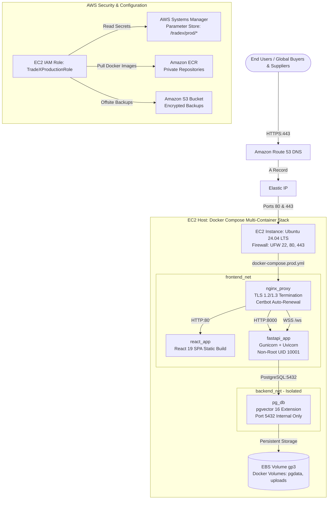

# TradeX AI: Production AWS EC2 & ECR Deployment Guide

This guide details the complete end-to-end production deployment of TradeX AI on Amazon Web Services (AWS) using Amazon Elastic Container Registry (ECR) and an Amazon EC2 instance running Ubuntu 24.04 LTS.

---

## 1. Cloud Architecture Overview



---

## 2. Security & Zero-Secret Architecture

TradeX AI adheres strictly to security best practices:
1. **No Plaintext Secrets on Disk**: Secrets and environment variables are retrieved at deployment runtime from AWS Systems Manager (SSM) Parameter Store using an EC2 IAM instance profile.
2. **Strict UFW Firewall**: Only SSH (22), HTTP (80), and HTTPS (443) are allowed on the EC2 host. The PostgreSQL port (`5432`) is bound solely inside the internal Docker bridge network (`backend_net`).
3. **Least Privilege Non-Root Container**: The FastAPI container runs under unprivileged UID `10001` (`appuser`).
4. **Automated Rollback Safety**: Deployments preserve the previous image tag in `.previous_tag`. If the health check fails, the stack rolls back automatically.

---

## 3. Step-by-Step Deployment Walkthrough

### Step 1: ECR Repositories and Image Build & Push

From your workstation or CI/CD runner:
1. Configure AWS CLI with deployer credentials:
   ```bash
   export AWS_REGION=us-east-1
   export AWS_ACCOUNT_ID=123456789012
   export ECR_REGISTRY="${AWS_ACCOUNT_ID}.dkr.ecr.${AWS_REGION}.amazonaws.com"
   ```

2. Log in to Amazon ECR:
   ```bash
   ./scripts/ecr-login.sh
   ```

3. Build and push production images (tagged with both Git commit SHA and `latest`):
   ```bash
   ./scripts/build-and-push.sh
   ```
   This script creates the private ECR repositories (`tradex-ai/backend`, `tradex-ai/frontend`, `tradex-ai/nginx`) if they do not already exist, builds optimized images, and pushes them.

---

### Step 2: IAM Instance Profile Setup

Create an IAM Role `TradeXProductionRole` and attach it to your EC2 instance. The role requires the following managed and inline policies:

```json
{
  "Version": "2012-10-17",
  "Statement": [
    {
      "Sid": "ECRImagePull",
      "Effect": "Allow",
      "Action": [
        "ecr:GetAuthorizationToken",
        "ecr:BatchCheckLayerAvailability",
        "ecr:GetDownloadUrlForLayer",
        "ecr:BatchGetImage"
      ],
      "Resource": "*"
    },
    {
      "Sid": "SSMParametersRead",
      "Effect": "Allow",
      "Action": [
        "ssm:GetParametersByPath",
        "ssm:GetParameter"
      ],
      "Resource": "arn:aws:ssm:*:*:parameter/tradex/prod/*"
    },
    {
      "Sid": "S3BackupUpload",
      "Effect": "Allow",
      "Action": [
        "s3:PutObject",
        "s3:GetObject",
        "s3:ListBucket"
      ],
      "Resource": [
        "arn:aws:s3:::tradex-prod-backups",
        "arn:aws:s3:::tradex-prod-backups/*"
      ]
    }
  ]
}
```

---

### Step 3: Populate SSM Parameter Store

Store production configuration in SSM Parameter Store (`SecureString` for credentials):

```bash
aws ssm put-parameter --name "/tradex/prod/ENV" --value "production" --type String
aws ssm put-parameter --name "/tradex/prod/DOMAIN" --value "tradex.yourdomain.com" --type String
aws ssm put-parameter --name "/tradex/prod/POSTGRES_USER" --value "tradex_prod_user" --type String
aws ssm put-parameter --name "/tradex/prod/POSTGRES_PASSWORD" --value "SuperSecurePassword123!" --type SecureString
aws ssm put-parameter --name "/tradex/prod/POSTGRES_DB" --value "tradex_prod" --type String
aws ssm put-parameter --name "/tradex/prod/DATABASE_URL" --value "postgresql+asyncpg://tradex_prod_user:SuperSecurePassword123!@db:5432/tradex_prod" --type SecureString
aws ssm put-parameter --name "/tradex/prod/SECRET_KEY" --value "$(openssl rand -hex 32)" --type SecureString
aws ssm put-parameter --name "/tradex/prod/OPENAI_API_KEY" --value "sk-prod-your-openai-key" --type SecureString
```

---

### Step 4: EC2 Instance Provisioning & Bootstrap

1. Launch an EC2 instance:
   - **AMI**: Ubuntu Server 24.04 LTS (HVM), SSD Volume Type
   - **Instance Type**: `t3.medium` (minimum for evaluation) or `t3.large` (recommended)
   - **Storage**: 30 GiB+ `gp3` root volume
   - **Security Group**: Inbound TCP 22 (SSH from admin IP), TCP 80 (HTTP from 0.0.0.0/0), TCP 443 (HTTPS from 0.0.0.0/0)
   - **IAM Role**: Attach `TradeXProductionRole`

2. Connect via SSH and run the bootstrap script:
   ```bash
   git clone https://github.com/Bhogeswarareddy/tradex-ai.git /tmp/tradex-ai
   sudo bash /tmp/tradex-ai/scripts/ec2-bootstrap.sh
   ```
   The bootstrap script automatically:
   - Updates APT packages and enables automatic security updates (`unattended-upgrades`).
   - Configures a 2GB swapfile for memory stability.
   - Installs Docker Engine, Docker Compose plugin, and AWS CLI v2.
   - Enables and configures UFW firewall (22, 80, 443).
   - Sets up `/opt/tradex-ai` with appropriate permissions.

---

### Step 5: Let's Encrypt SSL/TLS Certificate Setup

Obtain official TLS certificates with Let's Encrypt:

```bash
cd /opt/tradex-ai
DOMAIN=tradex.yourdomain.com EMAIL=admin@yourdomain.com ./scripts/certbot-init.sh
```

A cron job can be added to `/etc/cron.d/certbot-renew` to renew certificates every 60 days:
```cron
0 3 * * 1 root docker run --rm -v /opt/tradex-ai/certs:/etc/letsencrypt -v /opt/tradex-ai/certbot_www:/var/www/certbot certbot/certbot renew --webroot -w /var/www/certbot --quiet && docker exec nginx_proxy nginx -s reload
```

---

### Step 6: Deploy Application Stack

Deploy TradeX AI using the production deployment script:

```bash
export ECR_REGISTRY="123456789012.dkr.ecr.us-east-1.amazonaws.com"
export IMAGE_TAG="latest"

./scripts/deploy.sh
```

The deployment script executes the following atomic phases:
1. Retrieves production parameters from SSM Parameter Store into `/opt/tradex-ai/.env`.
2. Records current tag in `.previous_tag` for rollback safety.
3. Authenticates with ECR and pulls updated images (`docker compose -f docker-compose.prod.yml pull`).
4. Executes the database migration container (`docker compose -f docker-compose.prod.yml run --rm migrate`).
5. Starts all containers in daemon mode (`docker compose -f docker-compose.prod.yml up -d`).
6. Verifies health endpoint (`https://localhost/api/health`).
7. If health fails, performs automated rollback to `.previous_tag`.

---

## 4. Production Operations & Maintenance

### 4.1 System Status & Live Stats Report
Inspect resource consumption and container logs:
```bash
./scripts/stats-report.sh
```

### 4.2 Automated Daily Backups
Configure a cron job at `/etc/cron.d/tradex-backup`:
```cron
0 2 * * * root S3_BUCKET_NAME=tradex-prod-backups /opt/tradex-ai/scripts/backup.sh >> /var/log/tradex-backup.log 2>&1
```
This script creates compressed database dumps and document volume archives, prunes local archives keeping the last 7, and syncs to Amazon S3.

### 4.3 Database Restoration
To restore from a backup:
```bash
./scripts/restore.sh [TIMESTAMP]
```
If no timestamp is provided, it automatically restores the latest available backup.
