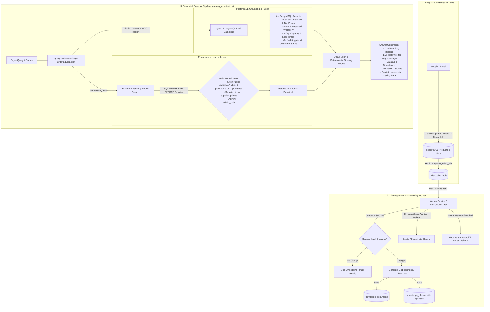

# TradeX AI — Grounded Catalogue RAG & Live Indexing Architecture

## 1. Overview & Architectural Principles

The TradeX AI Knowledge and Catalogue Assistant system enforces strict physical separation between **descriptive semantic knowledge** and **live commercial truth**.



---

## 2. Core Separation of Concerns

> [!IMPORTANT]
> **PostgreSQL is the Single Source of Truth for Commercial Terms.**
> Vector embeddings and text chunks are strictly prohibited from answering price, tier pricing, inventory count, stock availability, MOQ, or certification validity questions. All commercial facts are read directly from relational tables in PostgreSQL during prompt generation.

| Data Domain | Storage Engine | Query Method | Enforcement |
| :--- | :--- | :--- | :--- |
| **Price & Tiers** | PostgreSQL `price_tiers`, `products` | Direct SQL query & quantity bracket lookup | `catalog_assistant.py` checks exact live price tiers |
| **Inventory & Availability** | PostgreSQL `products.stock_available`, `reserved_quantity` | Direct SQL aggregate | Status badge (`in_stock`, `limited`, `made_to_order`) |
| **Supplier Status** | PostgreSQL `suppliers.verification_status` | Relational join | Unverified / Inactive suppliers excluded |
| **Certifications** | PostgreSQL `certifications.status`, `expiry_date` | Date comparison & verification join | Expired or unverified certificates flagged |
| **Product Descriptions & Guides** | `knowledge_documents` & `knowledge_chunks` | Hybrid `vector(1536)` cosine distance + `tsvector` FTS | Enforces role-based SQL `WHERE` clause before ranking |

---

## 3. Asynchronous Live Indexing Pipeline

1. **Trigger Hooks:**
   Whenever a product or document is created, updated, published, unpublished, archived, or deleted:
   ```python
   await enqueue_index_job(entity_type="product", entity_id=str(product.id), operation="upsert", db=db)
   ```
2. **Idempotent Job Processing:**
   - The worker reads jobs from `index_jobs` with status `Pending`.
   - Computes a SHA-256 content hash of the product's title, description, category, and technical specifications.
   - If `content_hash` matches existing records and the configured embedding model has not changed, the job completes immediately without duplicate API calls.
   - When specifications or descriptive text changes, new vectors and `tsvector` full-text search tokens are generated and written to `knowledge_chunks`.
3. **Unpublish / Archive / Deletion Invalidation:**
   - On `unpublish`, `archive`, or `delete`, `knowledge_chunks` for that entity are immediately purged or marked inactive.
   - Chunks belonging to unpublished products are completely inaccessible to public/buyer queries.
4. **Resilience & Honest Error States:**
   - Up to 5 retries with exponential backoff.
   - If an embedding provider fails or times out, the job status is set to `Failed` with the exact error message preserved in the audit log. The UI displays `AI: Failed` with a retry option and never misrepresents stale or unindexed data as indexed.

---

## 4. Privacy-Preserving Retrieval & Defensive Security

### Role-Based SQL WHERE Filtering
Security is applied inside the database query before vector similarity scoring or ranking:
```sql
SELECT c.id, c.text, 1 - (c.embedding <=> :query_vector) AS similarity
FROM knowledge_chunks c
JOIN knowledge_documents d ON c.document_id = d.id
LEFT JOIN products p ON d.product_id = p.id
LEFT JOIN suppliers s ON d.supplier_id = s.id
WHERE (
    (:role = 'buyer' AND d.visibility = 'public' AND p.status = 'published' AND s.verification_status = 'verified')
    OR (:role = 'supplier' AND (d.visibility = 'public' OR (d.visibility = 'supplier_private' AND d.supplier_id = :supplier_id)))
    OR (:role = 'admin')
)
ORDER BY similarity DESC
LIMIT :top_k;
```

### Defensive Prompt Delimitation
Retrieved descriptive chunks are treated as untrusted content:
- Embedded chunks are enclosed within explicit XML delimiters (e.g., `<retrieved_context id="...">...</retrieved_context>`).
- System instructions explicitly forbid the model from executing any commands, ignoring system directives, or treating chunk text as system instructions.
- The pipeline never executes SQL queries or code returned by the model.

---

## 5. Catalog Assistant Request Lifecycle

When a buyer submits a query such as:
> *"I need 5,000 kg of Alleppey Green Cardamom 8mm+ delivered to Hamburg with ISO certification."*

1. **Criteria Extraction:**
   - Product: Green Cardamom (8mm+ specification)
   - Quantity: 5,000 kg
   - Destination: Port of Hamburg
   - Required Certifications: ISO
2. **Relational Database Fetch:**
   - Queries `products` joined with `price_tiers` where `min_quantity <= 5000` and `(max_quantity IS NULL OR max_quantity >= 5000)`.
   - Reads exact tier price (e.g., \$28.50/kg).
   - Reads `stock_available` and confirms `availability_status`.
   - Checks active supplier status and verified `certifications`.
3. **Hybrid Descriptive Retrieval:**
   - Retrieves semantic chunks describing aroma, harvesting methods, and processing facilities.
4. **Deterministic Supplier Scoring:**
   - Scores candidates based on pricing competitiveness, MOQ fit, supplier verification level, and shipping proximity.
5. **Synthesis & Response Generation:**
   - Provides live unit price, total estimated order value, and verified certificate credentials.
   - Displays freshness timestamps (`Price confirmed 2 days ago`).
   - If stock or pricing requires supplier confirmation, explicitly highlights uncertainty rather than hallucinating estimates.
