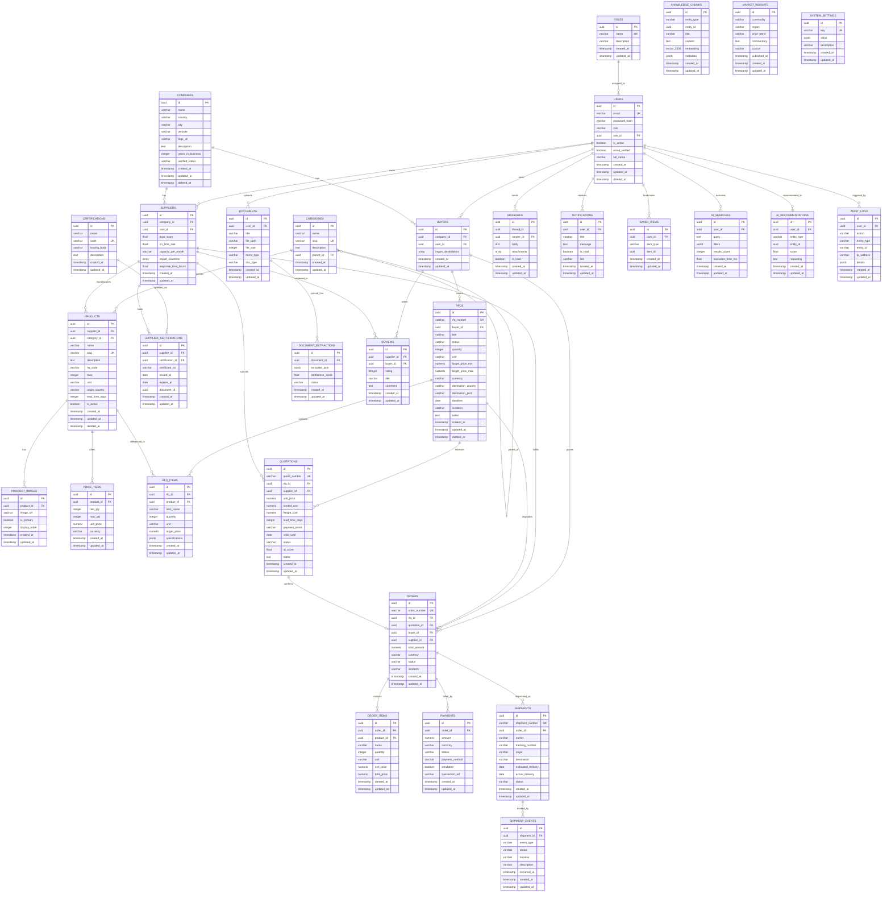

# TradeX AI: Entity Relationship Diagram (ERD)

This document visualizes the complete database schema for the TradeX AI platform, covering Identity, Catalog, Trade, Content, and AI/Ops domains.

---

## Mermaid ER Diagram

