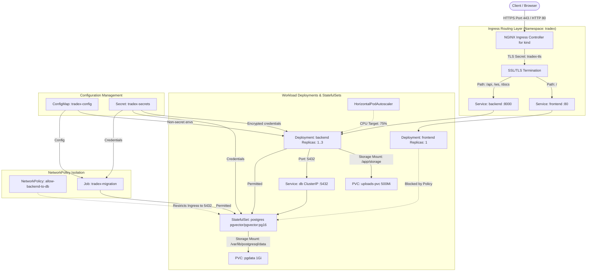

# TradeX AI — Kubernetes Architecture, Manifests & Operational Guide

This document details the complete Kubernetes deployment topology for TradeX AI, demonstrating multi-tier orchestration, self-healing, horizontal pod autoscaling, rolling updates, and volume persistence using a local **kind** (Kubernetes in Docker) cluster.

---

## 1. System Architecture

### 1.1 High-Level Mermaid Architecture Diagram



---

### 1.2 Full System ASCII Architecture Diagram ($\le 40$ chars wide)

```text
         PUBLIC TRAFFIC
                |
                v (Ports 80 / 443)
  +---------------------------+
  | NGINX Ingress Controller  |
  | - TLS Secret: tradex-tls  |
  | - HTTP -> HTTPS Redirect  |
  +---------------------------+
         |             |
         | /           | /api, /ws
         v             v
  +-----------+  +------------+
  | Service:  |  | Service:   |
  | frontend  |  | backend    |
  +-----------+  +------------+
         |             |
         v             v
  +-----------+  +------------+
  | Pod:      |  | Pods:      |
  | frontend  |  | backend    |
  | (React)   |  | (1..3 HPA) |
  +-----------+  +------------+
                       |
                       v Port 5432
                 +------------+
                 | Service: db|
                 +------------+
                       |
                       v
                 +------------+
                 | StatefulSet|
                 | postgres   |
                 | (pgvector) |
                 +------------+
                       |
                       v Persistent I/O
                 +------------+
                 | PVC: pgdata|
                 +------------+
```

---

## 2. Docker Compose vs. Kubernetes Concept Mapping

| Feature / Concept | Docker Compose (`docker-compose.free.yml`) | Kubernetes Manifests (`k8s/base/`) |
| :--- | :--- | :--- |
| **Service Tier** | `services.backend` (FastAPI) | `Deployment` (`backend.yaml`) + `Service` ClusterIP |
| **Frontend Tier** | `services.frontend` (React/Vite) | `Deployment` (`frontend.yaml`) + `Service` ClusterIP |
| **Database Tier** | `services.db` (Postgres 16) | `StatefulSet` (`postgres.yaml`) + Headless/ClusterIP `Service` |
| **Ingress & Proxy** | `services.nginx` (Reverse Proxy container) | `Ingress` (`ingress.yaml`) managed by NGINX Ingress Controller |
| **Data Persistence** | Named volume `pgdata:/var/lib/...` | `PersistentVolumeClaim` (PVC) + StorageClass |
| **Config & Envs** | `.env` file + `environment:` keys | `ConfigMap` (`configmap.yaml`) for non-secrets |
| **Secret Storage** | `.env` variables | `Secret` (`tradex-secrets`) populated via script |
| **Health Checks** | `healthcheck.test` (`pg_isready`, `curl`) | `readinessProbe` and `livenessProbe` |
| **Resource Limits** | `deploy.resources.limits.memory` | `resources.requests` and `resources.limits` |
| **Autoscaling** | Manual `docker compose up --scale backend=2` | `HorizontalPodAutoscaler` (HPA via metrics-server) |
| **Diagnostics** | `docker stats` and `docker compose logs` | `kubectl top pods` and `kubectl logs -l app=backend` |

---

## 3. How Container Images Flow in Kubernetes

### Option A: Local Cluster Flow (`kind`) — *Free Development & Review Demo*
1. **Local Build:** Build multi-stage Docker images locally:
   ```bash
   docker build -t tradex-ai-backend:latest ./backend
   docker build -t tradex-ai-frontend:latest ./frontend
   ```
2. **Cluster Ingestion:** Inject existing local Docker images directly into kind cluster nodes without a remote registry:
   ```bash
   kind load docker-image tradex-ai-backend:latest --name tradex-cluster
   kind load docker-image tradex-ai-frontend:latest --name tradex-cluster
   kind load docker-image pgvector/pgvector:pg16 --name tradex-cluster
   ```
3. **Workload Rollout:** Deploy workloads via `kubectl apply -k k8s/overlays/local`. Pods pull from the node's local image cache (`imagePullPolicy: IfNotPresent`).

### Option B: Remote Cloud Registry Flow (`AWS ECR`)
1. **Build & Tag:** Tag images with the AWS ECR URI (`533267347256.dkr.ecr.ap-south-1.amazonaws.com`).
2. **Push:** Authenticate with `aws ecr get-login-password` and push images.
3. **ImagePullSecret:** Create an AWS ECR pull secret in the `tradex` namespace:
   ```bash
   kubectl create secret docker-registry aws-ecr-secret \
     --namespace tradex \
     --docker-server=533267347256.dkr.ecr.ap-south-1.amazonaws.com \
     --docker-username=AWS \
     --docker-password=$(aws ecr get-login-password --region ap-south-1)
   ```
4. **Attach Secret:** Reference `imagePullSecrets: [{name: aws-ecr-secret}]` in `backend.yaml` and `frontend.yaml`.

---

## 4. Architectural Decision: Why Docker Compose on EC2 vs. Kubernetes on EKS

| Dimension | AWS EC2 with Docker Compose (Production) | AWS EKS Managed Kubernetes Cluster | Local kind Cluster (Evaluation Review) |
| :--- | :--- | :--- | :--- |
| **Monthly Cost** | **$0.00 / month** (AWS Free Tier: 750 hrs) | **~$73.00 / month** ($0.10/hr control plane alone + node costs) | **$0.00 / month** (Runs locally on PC) |
| **RAM Footprint** | **~520 MB total** (fits in 1 GB RAM on `t3.micro`) | Requires minimum 4 GB to 8 GB RAM (e.g. `t3.medium` or `t3.large`) | **~1.8 GB RAM** (Runs smoothly in Docker) |
| **Setup Complexity**| Single declarative `docker-compose.prod.yml` | Multi-VPC, OIDC IAM, ALB controller, EBS CSI driver | Kind cluster initialized in < 60 seconds |
| **Use Case** | Ideal for cost-sensitive SME production | Large multi-team enterprise with hundreds of microservices | Proof of Kubernetes competencies for Project Review |

> [!NOTE]
> Running Kubernetes control planes on AWS (EKS) incurs a fixed charge of \$0.10 per hour (\$73/month) regardless of cluster usage, which would violate the \$1.00 budget ceiling. Deploying Kubernetes on `kind` demonstrates full mastery of Kubernetes without spending money.

---

## 5. Upgrade Path: Running on k3s (Larger EC2) or AWS EKS

The exact same Kubernetes manifests located in `k8s/base/` run natively on production Kubernetes platforms:

### 5.1 Lightweight Production Option: k3s on a `t3.small` / `t3.medium` EC2
1. Launch an EC2 instance with 2 vCPUs and 2 to 4 GB RAM.
2. Install k3s with one curl command:
   ```bash
   curl -sfL https://get.k3s.io | sh -
   ```
3. Apply TradeX AI manifests:
   ```bash
   kubectl apply -k k8s/base/
   ```
4. k3s includes Traefik ingress and local-path storage by default.

### 5.2 Enterprise Production Option: Managed AWS EKS
1. Provision EKS cluster using `eksctl`:
   ```bash
   eksctl create cluster --name tradex-prod --region ap-south-1 --nodegroup-name standard-workers --node-type t3.medium --nodes 2
   ```
2. Install the AWS EBS CSI driver so `StatefulSet` PersistentVolumeClaims provision real AWS gp3 EBS disks.
3. Install the AWS Load Balancer Controller to translate `ingress.yaml` into an AWS Application Load Balancer (ALB).
4. Run `kubectl apply -k k8s/base/`.

---

## 6. CLI Management Commands

All Kubernetes operations are encapsulated in `Makefile` and `scripts/`:

```bash
# Start cluster, install ingress & metrics, create secrets, and deploy workloads
make k8s-up          # or: bash scripts/k8s-up.sh

# Check status of pods, services, ingress, and metrics
make k8s-status      # or: bash scripts/k8s-status.sh

# Run comprehensive diagnostic test suite (self-healing, scaling, rollback, persistence)
make k8s-test        # or: bash scripts/k8s-test.sh

# Run step-by-step interactive demo for evaluator
make k8s-demo        # or: bash scripts/k8s-demo.sh

# Tail workload logs
make k8s-logs        # or: bash scripts/k8s-logs.sh backend

# Tear down kind cluster
make k8s-down        # or: bash scripts/k8s-down.sh
```
